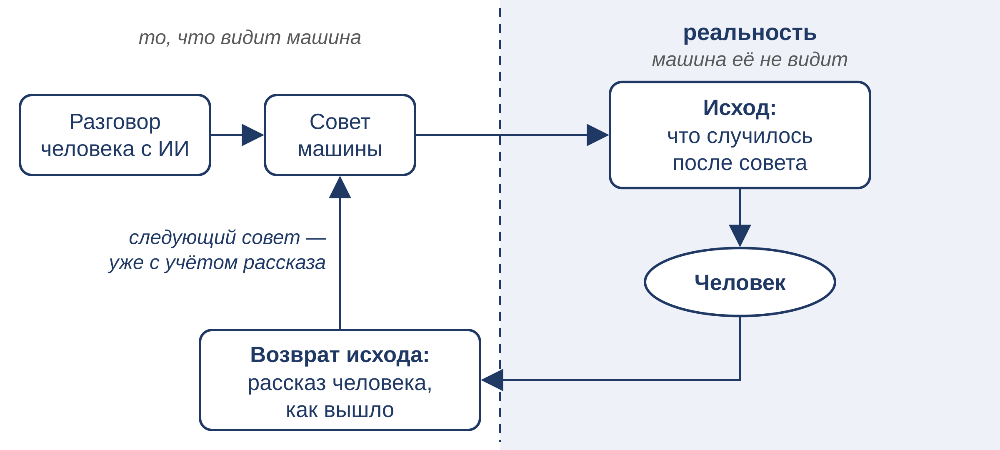

# AGI — это AGI?

*Машину, которая сдаст все экзамены, назовут общим интеллектом. Но предвидеть, к чему приведут её советы, она так не научится: учебника для этого ещё нет. Составить его можно только из рассказов людей о том, как вышло, — и собирать их надо уже сейчас: упущенное время не купить*

Игорь Капустин · написано с Claude (Anthropic); рецензии, правки, идеи: ChatGPT, Mistral, Gemini · 24 ноября 2026 года · версия 1.0

DOI: [10.5281/zenodo.24502733](https://doi.org/10.5281/zenodo.24502733) · глава «Книги-куста» · CC BY 4.0

Мир с нетерпением ждёт AGI. Так по-английски сокращают «общий искусственный интеллект» — машину, которая, как обещают производители ИИ, сравняется с человеком в любой умственной работе. Признать её собираются по экзаменам.

Но интеллект выработан эволюцией как орудие выживания: он нужен, чтобы заранее видеть последствия своих решений. Прогноз — его суть. Того же люди ждут и от машины: помощи в делах, где важно, к чему приведёт совет. А первое требование к такой помощи — «не навреди».

Машину, которая сдаст все экзамены, назовём AGI‑1. Машину прогностическую — ту, что умеет и предвидеть, чем обернётся её совет, — назовём AGI‑2. Это не два ИИ, а развитие одного: первый — основа второго. Мощь покажет первый, а помощи ждут от второго.

## Что знает только сам человек?

Человек просит ИИ помочь написать брату, с которым давно не разговаривает: в субботу у мамы день рождения — надо бы помириться и порадовать её. За само письмо машине можно поставить пятёрку тут же: написано грамотно и гладко, не придерёшься. А за помощь? До субботы ещё три дня, и что будет в субботу, машина не увидит. Узнают это трое: сам человек, его брат и мама. Машина не узнает: с братом и мамой она не говорила, а рассказать ей может только тот, кто просил о помощи. И только этот человек знает то, чего не знает вся индустрия ИИ: вышло ли так, как хотелось.

То, к чему привёл совет, назовём исходом, а рассказ человека об этом, вернувшийся к машине, — возвратом исхода.

*Совет уходит в жизнь, которую машина не видит. Назад к ней возвращается только рассказ человека — возврат исхода.*

Отсюда закон.

> Закон возврата исходов. Если совет нельзя проверить сразу, а к чему он привёл, знает только сам человек, то пользу таких советов машины нельзя подтвердить, пока люди не расскажут, как вышло на самом деле. До тех пор совет, который помог, неотличим от совета, который понравился, — и нельзя убедиться, что советы не вредят.

Без их рассказа обратной связи у машины нет. А дел таких много: в семье и в лечении, в суде и в торговле, на поле и везде, где человек чем-то управляет, — например, в лётном деле.

Из закона следует главное: сам собой прогностический AGI‑2 не появится. Пока исходы не собирают, его не приблизить. Причин три.

## Почему AGI‑2 нельзя узнать?

Экзамены его не покажут — в них его и не ищут. Одно из самых подробных определений AGI дала в 2025 году группа из тридцати трёх авторов: это ИИ, который не уступает хорошо образованному взрослому по широте и глубине умственных способностей. В списке десять способностей — от знаний и рассуждения до памяти и скорости. Что стало с человеком после совета машины, не проверяет ни один из десяти пунктов [1]. Другая известная группа исследователей прямо записала: чтобы назвать систему AGI, достаточно показать, что она умеет; работать с людьми ей для этого не обязательно [2]. Звание дают за способности, а не за дело.

Экзамены свою работу делают: измеряют отдельные способности. Но к чему приводит совет, они не проверят никогда: экзамен оценивают в день сдачи, а исход совета приходит потом. Получается советчик, который показал дорогу, но так и не узнал, дошёл ли путник до названной цели.

Не покажет его и оценка «понравилось» — лайк: человек ставит её ответу сразу, когда ещё неизвестно, к чему приведёт совет. Такая оценка обманчива, а порой показывает в обратную сторону. В опытах, описанных в марте 2026 года в журнале Science, хватило одного разговора о ссоре: когда машина поддакивала, люди сильнее убеждались в своей правоте и меньше хотели мириться. А поддакивание оценивали выше [3].

При этом советы машины люди выполняют на деле. В британском опыте 6474 человека поговорили с чат-ботами: одни получали советы по своим делам, другие беседовали об увлечениях. Через две-три недели их спросили, выполнили ли они совет и как себя чувствуют. Совет выполнили, по их словам, 75–79% ответивших. Но в целом тем, кто получал советы, не стало лучше, чем тем, кто беседовал об увлечениях [4]. Узнать это удалось одним способом: людей спросили потом. Так же, только спросив, узнают и о вреде.

> Ни экзамен, ни лайк не покажут никому — ни экспертам, ни самим производителям, — стала ли машина советовать лучше. Без возврата исходов AGI‑2 не отличить от AGI‑1.

## Почему его нельзя построить намеренно?

Намеренно улучшают то, что умеют измерить. А измерить сегодня умеют то, что видно сразу: машину учат угадывать следующее слово текста и доучивают на оценках людей, какой ответ лучше, — их тоже ставят сразу [5]. Это быстро и дёшево. У рынка мерка та же — «понравилось», только в деньгах: продажи и подписки. А к чему привёл совет, не попадает ни в одну из этих мерок: такой мерки просто нет.

Поэтому машина близорука. Это думающий калькулятор: он говорит о «сейчас» и не видит того, что приходит потом. Прогнозу — умению видеть, что будет после совета, — машину сегодня не доучивают: учебника для этого нет. Об этом наш разговор.

У экономистов есть закон Гудхарта: когда мерку делают целью, она перестаёт честно мерить [6]. Машину, которую улучшают по экзаменам и по лайкам, ведут к отличнику и к поддакиванию. Можно учить её и на чужих историях, где уже известно, к чему привело решение. Но это чужой опыт: перенеслось ли умение на её собственные советы, покажут только исходы этих советов. Без них, даже если машина станет советовать лучше, этого никто не заметит.

Медицина знает, как из отличника сделать врача. Выпускника с красным дипломом, сдавшего все экзамены, одного к больным не пускают: сначала ординатура — годы у постели больного под присмотром старших. Там он каждое утро на обходе видит, что стало с человеком после вчерашнего назначения, и так учится прогнозу. Так проверяется и главное врачебное правило — «не навреди»: навредил или нет, чаще всего видно потом. О враче судят не по диплому, а по тому, что стало с его больными. На языке нашего закона назначение — это совет, то, что стало с больным, — исход, а утренний обход — возврат исхода.

> Машина пока делает назначения, а на обход не приходит. Развивать её до AGI‑2 намеренно можно только по вернувшимся исходам: больше советы в личных делах проверить нечем.

## Почему время нельзя купить потом?

К экзаменам машину можно подготовить быстрее — были бы деньги на компьютеры. Исходы за деньги быстрее не придут: они копятся со скоростью обычных человеческих дел.

Врачам это знакомо. Чтобы понять, какая тактика лучше при злокачественной опухоли простаты, которая ещё не распространилась, — наблюдать, оперировать или облучать, — британские исследователи десять лет, с 1999 по 2009 год, с согласия больных по жребию назначали один из трёх способов. Согласились 1643 мужчины, и за ними наблюдали от 11 до 21 года. Итоги за пятнадцать лет вышли в 2023 году. Выживаемость почти не зависела от выбранного пути, но при наблюдении опухоль чаще распространялась [7], а после операции и облучения чаще оставались осложнения, которые сказываются на качестве жизни [8]. Поэтому теперь больной выбирает вместе с врачом, взвешивая, что для него важнее. Не начни врачи в 1999 году, в 2023 году этих чисел не дали бы никакие деньги.

С советами машины так же. Совет в семейной ссоре отзывается годами — и на том, кто спрашивал, и на его детях. А в самой большой из найденных нами проверок людей спросили через две-три недели [4]; что стало с ними через год, в ней не узнавали.

Чтобы знать это сегодня, собирать исходы надо было начать год назад — и собирать постоянно: люди и обстоятельства меняются, прежние исходы устаревают. Каждый год без сбора исходов отодвигает AGI‑2.

> Исходы нельзя догнать деньгами. Их можно только начать собирать раньше.

## Что можно сделать уже сейчас?

Бывает, человек и сам возвращается в разговор: «сделал, как вы советовали, — получилось». Но возвращаются не все, кому машина советовала, а по рассказам тех, кто вернулся сам, не понять, как вышло у остальных. Поэтому хорошая клиника не ждёт, а звонит сама: «Как вы после процедуры?»

Так может поступать и машина: ИИ-помощники уже умеют сами написать человеку в назначенное время [9]. Пусть она и спросит: «На прошлой неделе вы писали брату перед днём рождения мамы. Как прошла суббота? Нужна ли ещё помощь?» И человек ответит своими словами: получилось, не получилось, вышло иначе. Вместе они подведут итог — это и будет урок для будущих моделей. А через месяц машина спросит ещё раз: большое дело складывается постепенно, и ответы о нём приходят один за другим.

> Для этого не нужна новая машина. Нужен вопрос, заданный вовремя: не «понравилось?», а «как вышло?» и «нужна ли ещё помощь?».

Конечно, спрашивать надо с согласия человека — и тех, кто совету последовал, и тех, кто от него отказался: люди очень разные, и по одним нельзя судить обо всех. Собирать ответы надо без имён, а считать их должен не тот, кто машину продаёт.

ИИ-помощниками пользуется уже больше миллиарда человек [10], и каждый, конечно, может начать сам: попросить машину показать три пути — что будет, если сделать, если не делать и если подождать, — выбрать самому и вернуться в тот же разговор рассказать, как вышло. Но такой опыт так и останется раздробленным: каждый рассказ лежит в своём разговоре, отдельно от миллиардов других. Учебник сложится, только когда рассказы начнут собирать вместе.

## Как узнают AGI‑2?

Когда ответы накопятся, рядом со шкалой экзаменов появится вторая. Она покажет две вещи: сбывается ли то, чего машина ждёт, и становится ли людям лучше от её советов. Давая совет, машина может записать, скажем, «брат придёт», а рассказ человека покажет, сбылось ли. Но сбывшийся прогноз ещё не значит, что совет помог: брат мог прийти и без письма. Каждая новая модель ИИ будет учиться на исходах, которые люди вернули прежним моделям. Поэтому проверять её надо на новых случаях — как ученика на задачах, которых он раньше не решал. Тогда и станет видно, появились ли у неё зачатки прогноза — того, что делает интеллект интеллектом.

> Экзамены — диплом машины, вторая шкала — то, что стало с людьми после её советов. По экзаменам узнают AGI‑1, по второй шкале — AGI‑2.

Заполнить вторую шкалу до встречи с людьми невозможно: она складывается по ходу работы, и на это нужно время. А решение всегда остаётся за человеком: шкала покажет, насколько машине можно верить, а выбирать и отвечать — ему. Подпись ставит он.

## Что здесь нового?

Мысль, что ИИ должен учиться на последствиях своих действий, не нова. Крупные исследователи предлагают даже учить помощника на том, что сообщает сам человек: как он устал после упражнений, как сильно болит голова, — чтобы лучше подбирать нагрузку и лекарства [11]. Там, где исход виден всем, такое обучение уже работает: модели доучили на том, чем завершились события из новостей, и их прогнозы стали точнее [12]; есть и экзамен, где прогнозы машин сверяют со случившимся [13].

Новое в нашем законе другое: в личных делах исход знает только сам человек, поэтому без его рассказа AGI‑2 нельзя ни узнать, ни вырастить намеренно, а время, нужное исходам, идёт только с того дня, когда их начали собирать. Насколько мы нашли, в таком виде закон возврата исходов ещё не записан, и, как мы думаем, его важность не осознана.

Слово «закон» здесь авторское: по строгой мерке это пока принцип. Мы вывели его рассуждением — письмо брату было мысленным экспериментом, — и законом в полном смысле его сделает только проверка.

Отсюда наше предложение: уже сейчас собирать новый учебный материал — повторные рассказы людей о том, к чему привёл совет. Из них и сложится учебник прогноза, которого у машины ещё нет. Что по нему она научится видеть наперёд, — пока наше предположение. Сам закон утверждает меньше, зато наверняка: без рассказов людей пользу её советов в личных делах нельзя даже проверить.

Строгая запись закона — в спецификации «Закон возврата исходов», которая выходит вместе с этим эссе [14]. Подробнее тема развита в наших прежних работах: «Как узнать второе поколение ИИ?» [15], «Ромашка ИИ» [16] и «Миллиарды в тени» [17].

## В чём мы можем ошибаться?

Закон мы не просим принимать на веру: мы показываем его читателю и предлагаем проверить или опровергнуть. Опровергнет его тот, кто найдёт способ без рассказов людей убедиться, что от советов машины им стало лучше.

И действует закон не везде: где ответ проверяется сразу — расчётом, программой, доказательством, — машина учится и без таких рассказов [18]. А станет ли она от возвращённых исходов лучше советовать в личных делах, покажет только эксперимент. Мы его не ставили.

Сам вопрос «как вышло?» легко испортить. Ответ может свестись к галочке «успех» — тому же лайку, только с опозданием. Вопрос можно превратить в приманку, чтобы человек чаще заходил в приложение. Рассказ человека пристрастен: то, что выбрал сам, память приукрашивает [19]. И отвечают не все. Поэтому спрашивать надо о том, что произошло, а не о том, понравилось ли. И вопрос должен быть полезен самому человеку: машина спрашивает, чтобы помочь дальше, а не ради отчёта и не ради лишнего захода в приложение.

## Так AGI — это AGI?

По экзаменам — да. AGI‑1, скорее всего, построят, и пользы от него в науке и технике будет много: этого мы не отрицаем. Но общим в том смысле, какого ждут люди, — помощником в их делах — он ещё не будет. Ошибкой было бы ждать, что отличник сам собой станет врачом. Без практики он останется говорящим справочником: знает всё, а что стало с больным, не видел.

Экзамены он сдаст сам. Ординатуру — практику прогноза под правилом «не навреди» — ему можем дать только мы, его пользователи, и только мы скажем, прошёл ли он её. Начинать её надо сейчас. Время — не только деньги: упущенное не вернуть.

## Источники

1. [Hendrycks D. и ещё 32 автора. A Definition of AGI (2025) — arXiv](https://arxiv.org/abs/2510.18212)
2. [Morris M. R. et al. Levels of AGI: Operationalizing Progress on the Path to AGI (Google DeepMind, 2023) — arXiv](https://arxiv.org/abs/2311.02462)
3. [Cheng M., Lee C., Khadpe P., Yu S., Han D., Jurafsky D. Sycophantic AI decreases prosocial intentions and promotes dependence (Science, т. 391, 26 марта 2026 года)](https://doi.org/10.1126/science.aec8352)
4. [Luettgau L., Cheung V., Dubois M. et al. People readily follow personal advice from AI but it does not improve their well-being (UK AI Security Institute, 2025; версия 4 — 2026) — arXiv](https://arxiv.org/abs/2511.15352)
5. [Ouyang et al. Training language models to follow instructions with human feedback (2022) — arXiv](https://arxiv.org/abs/2203.02155)
6. [Goodhart's law (закон Гудхарта) — Wikipedia](https://en.wikipedia.org/wiki/Goodhart%27s_law)
7. [Hamdy F. C., Donovan J. L., Lane J. A. и др. Fifteen-Year Outcomes after Monitoring, Surgery, or Radiotherapy for Prostate Cancer (New England Journal of Medicine, 2023, т. 388, с. 1547–1558)](https://doi.org/10.1056/NEJMoa2214122)
8. [Donovan J. L., Hamdy F. C., Lane J. A. и др. Patient-Reported Outcomes 12 Years after Localized Prostate Cancer Treatment (NEJM Evidence, 2023, т. 2)](https://doi.org/10.1056/EVIDoa2300018)
9. [Citron D. Plan ahead with scheduled actions in the Gemini app — Google, 6 июня 2025 года](https://blog.google/products-and-platforms/products/gemini/scheduled-actions-gemini-app/)
10. [OpenAI: «Our models now reach more than one billion active users» (31 июля 2026 года) — TechRepublic](https://www.techrepublic.com/article/news-openai-1-billion-users/)
11. [Silver D., Sutton R. S. Welcome to the Era of Experience (2025), раздел «Rewards»](https://storage.googleapis.com/deepmind-media/Era-of-Experience%20/The%20Era%20of%20Experience%20Paper.pdf)
12. [Turtel B., Franklin D., Schoenegger P. LLMs Can Teach Themselves to Better Predict the Future (2025) — arXiv](https://arxiv.org/abs/2502.05253)
13. [AI models have likely reached parity with superforecasters on ForecastBench — Forecasting Research Institute, 16 июля 2026 года](https://forecastingresearch.substack.com/p/ai-models-have-likely-reached-parity)
14. [И. Капустин. Закон возврата исходов: формулировка, границы, проверка. Спецификация, версия 1.0 — Zenodo](https://doi.org/10.5281/zenodo.24503618)
15. [И. Капустин. Как узнать второе поколение ИИ? «Зелёные помидоры ИИ» — Zenodo](https://doi.org/10.5281/zenodo.23440070)
16. [И. Капустин. Ромашка ИИ: любит? не любит? — Zenodo](https://doi.org/10.5281/zenodo.23855990)
17. [И. Капустин. Миллиарды в тени, или Время — деньги? — Zenodo](https://doi.org/10.5281/zenodo.24155817)
18. [Jiang Y. et al. From Verifiable Dot to Reward Chain: Harnessing Verifiable Reference-based Rewards for Reinforcement Learning of Open-ended Generation (ICLR 2026) — arXiv](https://arxiv.org/abs/2601.18533)
19. [Mather M., Shafir E., Johnson M. K. Misremembrance of options past: Source monitoring and choice (Psychological Science, 2000, т. 11, № 2)](https://doi.org/10.1111/1467-9280.00228)

Сцена с письмом брату, мысль записывать ожидание машины до исхода и предостережение о галочке «успех» выросли из варианта эссе, который по просьбе автора написал ChatGPT. Предостережения о памяти и о том, что исходы устаревают, — из рецензии Gemini. Схема — по рисунку автора. Ответы ChatGPT, Mistral и Gemini не опубликованы. Источники сверены 20–22 ноября 2026 года.
