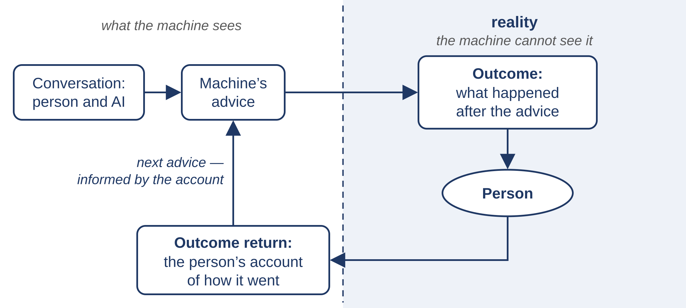

# Is AGI Really General?

*A machine that passes every exam will be called general intelligence. But that is not how it will learn to foresee where its advice leads: there is no textbook for that yet. Such a textbook can be compiled only from people’s accounts of how things turned out — and they must be collected now: lost time cannot be bought*

Igor Kapustin · written with Claude (Anthropic); reviews, edits, ideas: ChatGPT, Mistral, Gemini · 24 November 2026 · version 1.0

DOI: [10.5281/zenodo.24502733](https://doi.org/10.5281/zenodo.24502733) · a chapter of The Bush Book · CC BY 4.0

The world is eagerly waiting for AGI — artificial general intelligence: a machine that, as AI makers promise, will equal a human in any kind of intellectual work. The plan is to recognize it by exams.

But intelligence was shaped by evolution as a tool for survival: it exists to see the consequences of one’s decisions in advance. Forecasting is its essence. People expect the same from the machine: help in matters where what counts is where the advice will lead. And the first requirement for such help is “do no harm”.

Let us call the machine that passes every exam AGI‑1. The prognostic machine — the one that can also foresee what its advice will lead to — we will call AGI‑2. These are not two AIs but the development of one: the first is the foundation of the second. The first will show its power, but it is the second that people expect help from.

## What does only the person know?

A person asks an AI to help him write to his brother, with whom he has not spoken for a long time: their mother’s birthday is on Saturday, and it would be good to make peace and make her happy. The letter itself could get an A on the spot: it is well written and smooth, with nothing to fault. But what about the help? Saturday is three days away, and the machine will not see what happens then. Three people will know: the person himself, his brother and their mother. The machine will not: it never spoke with the brother or the mother, and only the one who asked for help can tell it. And only this person knows what the whole AI industry does not: whether things turned out as he hoped.

What the advice led to we will call the outcome; the person’s account of it, coming back to the machine, we will call the outcome return.

*Advice goes out into life, which the machine does not see. All that comes back to it is the person’s account — the outcome return.*

Hence the law.

> The Law of Returned Outcomes. If advice cannot be checked at once, and only the person knows what it led to, then the usefulness of such advice from a machine cannot be confirmed until people tell how things actually turned out. Until then, advice that helped is indistinguishable from advice that was liked — and there is no way to make sure the advice does no harm.

Without their accounts the machine has no feedback. And there are many such matters: in families and in medical treatment, in courts and in trade, on farms, and wherever a person is in control of something — in aviation, for example.

The main thing follows from the law: prognostic AGI‑2 will not appear by itself. As long as outcomes are not collected, it cannot be brought any closer. There are three reasons.

## Why can’t AGI‑2 be recognized?

Exams will not reveal it — they do not even look for it. One of the most detailed definitions of AGI was offered in 2025 by a group of thirty-three authors: an AI that matches a well-educated adult in the breadth and depth of its cognitive abilities. The list holds ten abilities, from knowledge and reasoning to memory and speed. Not one of the ten items checks what became of a person after the machine’s advice [1]. Another well-known group of researchers put it plainly: to call a system AGI, it is enough to show what it can do; it does not have to work with people for that [2]. The title is awarded for abilities, not for deeds.

Exams do their job: they measure separate abilities. But they will never check where advice leads: an exam is graded on the day it is taken, while the outcome of advice comes later. What we get is an adviser who showed the way but never found out whether the traveller reached the place he had named.

Nor will the “liked it” rating — the like — reveal it: a person gives it to an answer straight away, while it is still unknown where the advice will lead. Such a rating is misleading, and sometimes points the wrong way. In experiments published in Science in March 2026, a single conversation about a quarrel was enough: when the machine simply agreed with people, they grew more convinced they were right and less willing to make up. Yet people rated such agreement higher [3].

Meanwhile, people do act on the machine’s advice. In a British study, 6,474 people talked with chatbots: some received advice on their own affairs, others chatted about hobbies. Two to three weeks later they were asked whether they had followed the advice and how they felt. By their own account, 75–79% of those who answered had followed it. But overall, those who received advice were no better off than those who chatted about hobbies [4]. There was only one way to learn this: people were asked afterwards. Harm, too, can be learned of only by asking.

> Neither an exam nor a like will show anyone — not experts, not even the makers — whether the machine has begun to give better advice. Without outcome returns, AGI‑2 cannot be told apart from AGI‑1.

## Why can’t it be built on purpose?

What gets improved on purpose is what can be measured. And what can be measured today is what is visible at once: the machine is taught to guess the next word of a text and then further trained on people’s ratings of which answer is better — ratings that are also given at once [5]. This is fast and cheap. The market’s yardstick is the same “liked it”, only in money: sales and subscriptions. But where the advice led enters none of these yardsticks: such a yardstick simply does not exist.

That is why the machine is short-sighted. It is a thinking calculator: it speaks of “now” and does not see what comes later. Its training today stops short of forecasting — the ability to see what will happen after the advice: there is no textbook for it. That is what this conversation is about.

Economists have Goodhart’s law: when a measure becomes a target, it stops measuring honestly [6]. A machine improved by exams and likes is being steered toward the straight-A student and the yes-man. It can also be taught on other people’s stories in which it is already known what a decision led to. But that is someone else’s experience: whether the skill has carried over to its own advice will be shown only by the outcomes of that advice. Without them, even if the machine starts advising better, nobody will notice.

Medicine knows how to turn a straight-A student into a doctor. A graduate with an honours diploma who has passed every exam is not let near patients alone: first comes residency — years at the bedside under the eye of senior doctors. There, every morning on rounds, the young doctor sees what has become of a patient after yesterday’s prescription, and that is how he learns to forecast. That is also how the main rule of medicine — “do no harm” — is checked: whether harm was done is most often seen later. A doctor is judged not by his diploma but by what became of his patients. In the language of our law, the prescription is the advice, what became of the patient is the outcome, and the morning round is the outcome return.

> For now, the machine writes prescriptions but never comes on rounds. It can be developed into AGI‑2 on purpose only through returned outcomes: there is nothing else to check advice on personal matters against.

## Why can’t time be bought later?

A machine can be prepared for exams faster — given money for computers. Outcomes will not come faster for money: they accumulate at the pace of ordinary human affairs.

Doctors know this. To find out which approach is best for a malignant prostate tumour that has not yet spread — to monitor it, to operate or to irradiate — British researchers spent ten years, from 1999 to 2009, assigning one of the three by lot, with the patients’ consent. In all, 1,643 men agreed, and they were followed for 11 to 21 years. The fifteen-year results came out in 2023. Survival hardly depended on the path chosen, but under monitoring the tumour spread more often [7], while after surgery and radiotherapy complications affecting quality of life remained more often [8]. So now the patient chooses together with the doctor, weighing what matters more to him. Had the doctors not started in 1999, no amount of money could have produced these numbers in 2023.

It is the same with the machine’s advice. Advice in a family quarrel echoes for years — in the life of the one who asked and in the lives of his children. Yet in the largest of the studies we found, people were asked after two to three weeks [4]; what became of them a year later, that study did not find out.

To know this today, outcome collection should have begun a year ago — and it has to go on all the time: people and circumstances change, and old outcomes go out of date. Every year without collecting outcomes pushes AGI‑2 further away.

> You cannot catch up on outcomes with money. You can only start collecting them sooner.

## What can be done right now?

Sometimes a person comes back to the conversation on his own: “I did as you advised — it worked.” But not everyone the machine advised comes back, and the accounts of those who return on their own do not show how things went for the rest. That is why a good clinic does not wait but calls the patient itself: “How are you after the procedure?”

The machine can do the same: AI assistants can already message a person on their own at a set time [9]. Let it ask: “Last week you wrote to your brother before your mother’s birthday. How did Saturday go? Do you need any more help?” And the person will answer in his own words: it worked, it didn’t, it turned out differently. Together they will sum it up — and that will be a lesson for future models. A month later the machine will ask again: a big matter takes shape gradually, and the answers about it come one after another.

> This does not need a new machine. It needs a question asked at the right time: not “Did you like it?” but “How did it turn out?” and “Do you need any more help?”.

Of course, people must be asked only with their consent — both those who followed the advice and those who declined it: people are very different, and you cannot judge all of them by some. The answers must be collected without names, and they must not be counted by whoever sells the machine.

More than a billion people already use AI assistants [10], and anyone, of course, can start on their own: ask the machine to show three paths — what will happen if you act, if you don’t, and if you wait — choose for yourself, and come back to the same conversation to tell how it turned out. But such experience will stay fragmented: each account sits in its own conversation, apart from billions of others. A textbook will take shape only when the accounts begin to be collected together.

## How will AGI‑2 be recognized?

When the answers accumulate, a second scale will appear next to the exam scale. It will show two things: whether what the machine expects comes true, and whether people are better off for its advice. When giving advice, the machine can write down, say, “the brother will come”, and the person’s account will show whether it came true. But a forecast that came true does not yet mean the advice helped: the brother might have come without the letter. Each new AI model will learn from the outcomes that people returned to earlier models. That is why it must be tested on new cases — like a student on problems he has not solved before. Only then will it become clear whether it has the beginnings of foresight — the thing that makes intelligence intelligence.

> Exams are the machine’s diploma; the second scale is what became of people after its advice. AGI‑1 is recognized by exams, AGI‑2 by the second scale.

The second scale cannot be filled in before meeting people: it builds up in the course of work, and that takes time. And the decision always stays with the person: the scale will show how far the machine can be trusted, but the choice and the responsibility are his. He is the one who signs.

## What is new here?

The idea that AI should learn from the consequences of its actions is not new. Leading researchers even propose training an assistant on what the person himself reports — how tired he is after exercise, how bad his headache is — so as to better adjust the training load and the medicine [11]. Where the outcome is visible to everyone, such training already works: models were further trained on how events in the news turned out, and their forecasts became more accurate [12]; there is also an exam in which machine forecasts are checked against what actually happened [13].

What is new in our law is something else: in personal matters only the person knows the outcome, so without his account AGI‑2 can be neither recognized nor grown on purpose, and the time that outcomes need runs only from the day their collection begins. As far as we have found, the law of returned outcomes has not been written down in this form, and, we believe, its importance has not been realized.

The word “law” here is the author’s choice: by strict standards it is, so far, a principle. We derived it by reasoning — the letter to the brother was a thought experiment — and only testing will make it a law in the full sense.

Hence our proposal: start collecting new training material right now — people’s repeated accounts of where advice led. From them the textbook of foresight that the machine still lacks will be compiled. That the machine will learn from it to see ahead is, for now, our supposition. The law itself claims less, but with certainty: without people’s accounts, the usefulness of the machine’s advice in personal matters cannot even be checked.

The strict statement of the law is in the specification “The Law of Returned Outcomes”, published together with this essay [14]. The topic is developed further in our earlier works: “How Will We Know Second-Generation AI?” [15], “The AI Daisy” [16] and “Billions in the Shadow” [17].

## Where might we be wrong?

We do not ask anyone to take the law on faith: we show it to the reader and invite them to test or refute it. It will be refuted by whoever finds a way to make sure, without people’s accounts, that the machine’s advice made them better off.

Nor does the law hold everywhere: where an answer is checked at once — by a calculation, a program, a proof — the machine learns without such accounts [18]. Whether returned outcomes will make it give better advice in personal matters, only an experiment will show. We have not run it.

The question “How did it turn out?” itself is easy to spoil. The answer may shrink to a “success” checkbox — the same like, only delayed. The question can be turned into bait to make people open the app more often. A person’s account is biased: memory embellishes what one chose oneself [19]. And not everyone answers. That is why people should be asked about what happened, not about whether they liked it. And the question must be useful to the person: the machine asks in order to help further, not for a report and not for one more visit to the app.

## So, is AGI really general?

By the exams — yes. AGI‑1 will most likely be built, and it will be of great use in science and engineering: we do not deny that. But it will not yet be general in the sense people expect — a helper in their own affairs. It would be a mistake to expect a straight-A student to become a doctor by himself. Without practice he will remain a talking reference book: he knows everything, yet has never seen what became of the patient.

It will pass the exams on its own. Residency — the practice of forecasting under the rule “do no harm” — only we, its users, can give it, and only we can say whether it has completed it. It has to begin now. Time is not only money: what is lost cannot be returned.

## References

1. [Hendrycks D. and 32 co-authors. A Definition of AGI (2025) — arXiv](https://arxiv.org/abs/2510.18212)
2. [Morris M. R. et al. Levels of AGI: Operationalizing Progress on the Path to AGI (Google DeepMind, 2023) — arXiv](https://arxiv.org/abs/2311.02462)
3. [Cheng M., Lee C., Khadpe P., Yu S., Han D., Jurafsky D. Sycophantic AI decreases prosocial intentions and promotes dependence (Science, vol. 391, 26 March 2026)](https://doi.org/10.1126/science.aec8352)
4. [Luettgau L., Cheung V., Dubois M. et al. People readily follow personal advice from AI but it does not improve their well-being (UK AI Security Institute, 2025; version 4 — 2026) — arXiv](https://arxiv.org/abs/2511.15352)
5. [Ouyang et al. Training language models to follow instructions with human feedback (2022) — arXiv](https://arxiv.org/abs/2203.02155)
6. [Goodhart’s law — Wikipedia](https://en.wikipedia.org/wiki/Goodhart%27s_law)
7. [Hamdy F. C., Donovan J. L., Lane J. A. et al. Fifteen-Year Outcomes after Monitoring, Surgery, or Radiotherapy for Prostate Cancer (New England Journal of Medicine, 2023, vol. 388, pp. 1547–1558)](https://doi.org/10.1056/NEJMoa2214122)
8. [Donovan J. L., Hamdy F. C., Lane J. A. et al. Patient-Reported Outcomes 12 Years after Localized Prostate Cancer Treatment (NEJM Evidence, 2023, vol. 2)](https://doi.org/10.1056/EVIDoa2300018)
9. [Citron D. Plan ahead with scheduled actions in the Gemini app — Google, 6 June 2025](https://blog.google/products-and-platforms/products/gemini/scheduled-actions-gemini-app/)
10. [OpenAI: “Our models now reach more than one billion active users” (31 July 2026) — TechRepublic](https://www.techrepublic.com/article/news-openai-1-billion-users/)
11. [Silver D., Sutton R. S. Welcome to the Era of Experience (2025), section “Rewards”](https://storage.googleapis.com/deepmind-media/Era-of-Experience%20/The%20Era%20of%20Experience%20Paper.pdf)
12. [Turtel B., Franklin D., Schoenegger P. LLMs Can Teach Themselves to Better Predict the Future (2025) — arXiv](https://arxiv.org/abs/2502.05253)
13. [AI models have likely reached parity with superforecasters on ForecastBench — Forecasting Research Institute, 16 July 2026](https://forecastingresearch.substack.com/p/ai-models-have-likely-reached-parity)
14. [Kapustin I. The Law of Returned Outcomes: Statement, Scope, Testing. Specification, version 1.0 — Zenodo](https://doi.org/10.5281/zenodo.24503618)
15. [Kapustin I. How Will We Know Second-Generation AI? (“AI’s Green Tomatoes”) — Zenodo](https://doi.org/10.5281/zenodo.23440070)
16. [Kapustin I. The AI Daisy: Loves Me? Loves Me Not? — Zenodo](https://doi.org/10.5281/zenodo.23855990)
17. [Kapustin I. Billions in the Shadow, or Time Is Money? — Zenodo](https://doi.org/10.5281/zenodo.24155817)
18. [Jiang Y. et al. From Verifiable Dot to Reward Chain: Harnessing Verifiable Reference-based Rewards for Reinforcement Learning of Open-ended Generation (ICLR 2026) — arXiv](https://arxiv.org/abs/2601.18533)
19. [Mather M., Shafir E., Johnson M. K. Misremembrance of options past: Source monitoring and choice (Psychological Science, 2000, vol. 11, no. 2)](https://doi.org/10.1111/1467-9280.00228)

The scene with the letter to the brother, the idea of having the machine write down its expectation before the outcome, and the warning about the “success” checkbox grew out of a version of the essay that ChatGPT wrote at the author’s request. The warnings about memory and about outcomes going out of date come from Gemini’s review. The diagram is based on the author’s drawing. The replies of ChatGPT, Mistral and Gemini are unpublished. Sources were checked on 20–22 November 2026. Translated from the Russian original with Claude on 23 November 2026.
